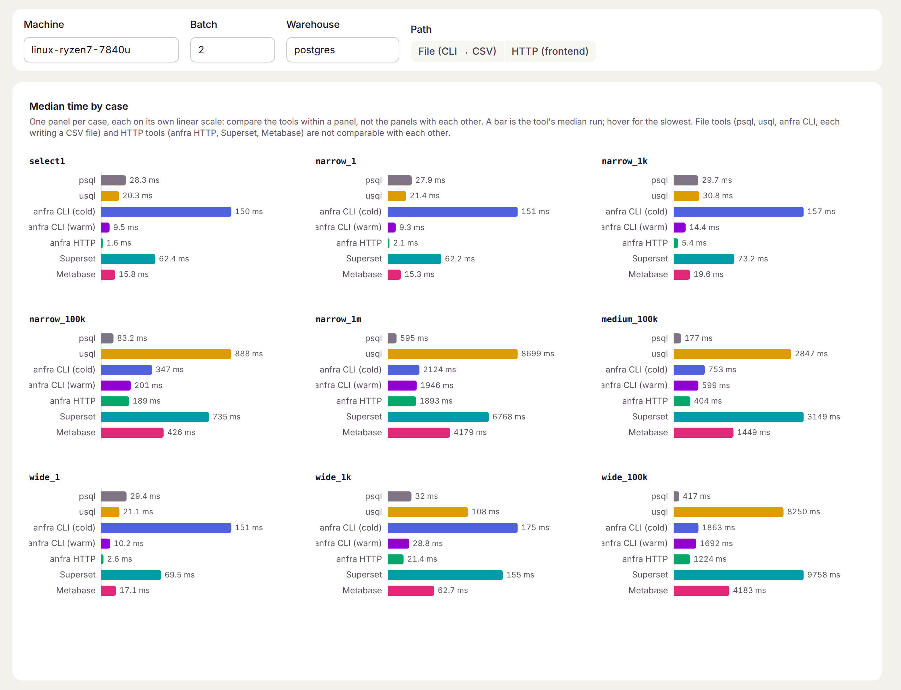
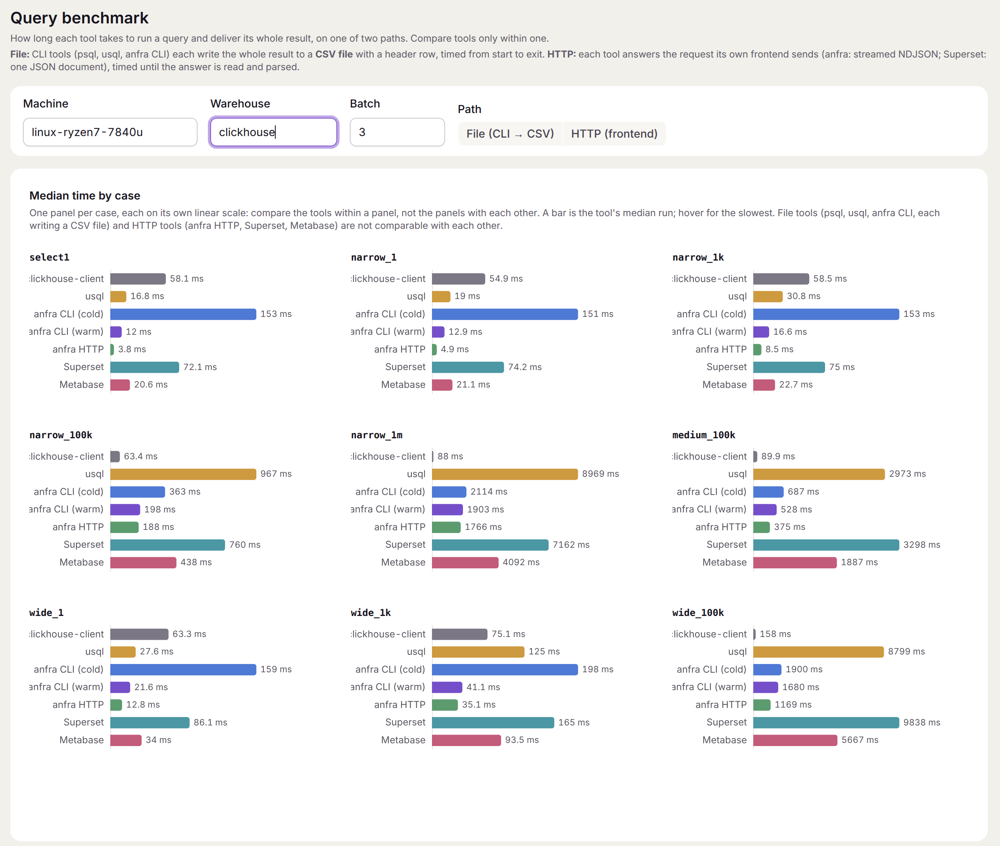
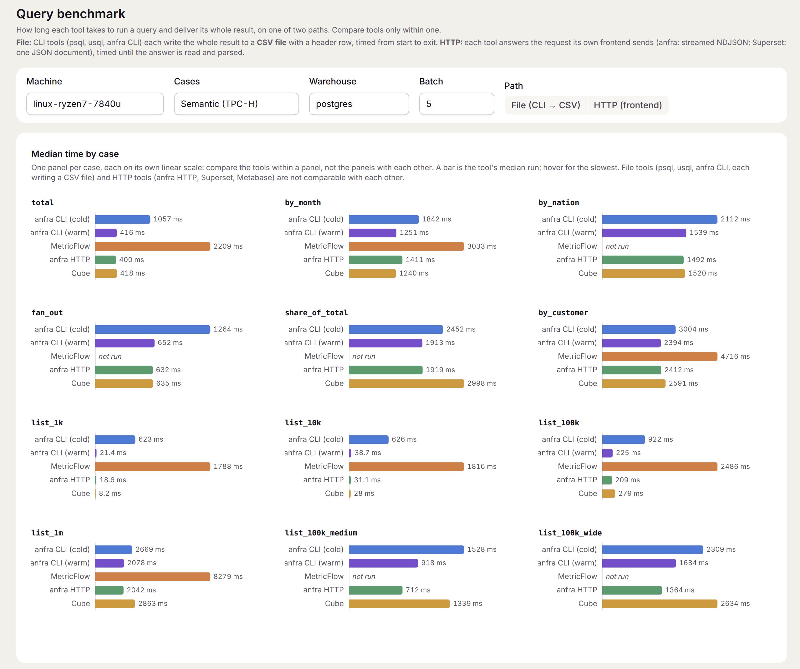
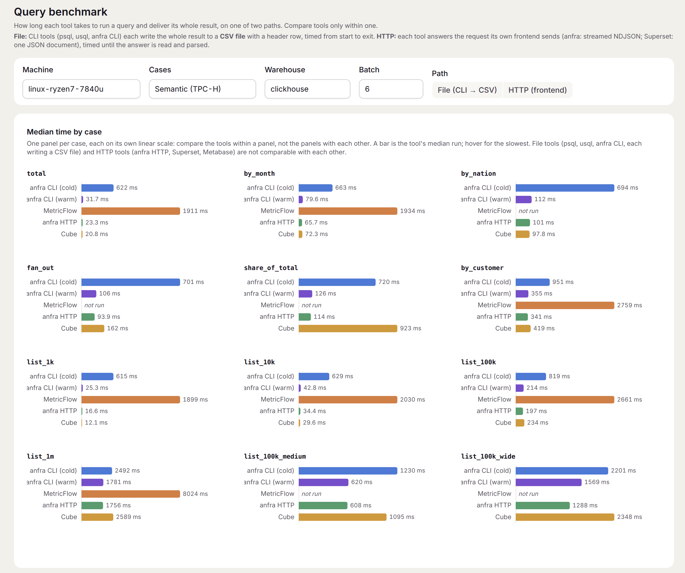

# Query benchmark

How long anfra takes to run a query and hand over its whole result, against
popular open-source tools, on the same warehouse with the same query.

This README is the plan: what is measured, in what order, and why, and where
the results are. [IMPLEMENTATION.md](IMPLEMENTATION.md) says how it runs, and
how to run a batch yourself.

> **How fair is it?** For each tool, we use the best way we know to run a query
> and get its whole result, on the path its own users take: its CLI writing a
> CSV file, or the API its own frontend calls. Caches are off, and row limits
> raised so every case returns whole. We may be missing a better method, or a
> setting that would make a tool faster. Each tool's exact setup is in
> [IMPLEMENTATION.md](IMPLEMENTATION.md). If you know a better way, tell us, and
> we will measure it.

## Results so far

| Batch | Warehouse | Tools | Write-up |
|---|---|---|---|
| 1 | Postgres | psql, usql, anfra (CLI cold, CLI warm, HTTP), Superset | [batch1.md](results/linux-ryzen7-7840u/batch1.md) |
| 2 | Postgres | psql, usql, anfra (CLI cold, CLI warm, HTTP), Superset, **Metabase** | [batch2.md](results/linux-ryzen7-7840u/batch2.md) |
| 3 | ClickHouse | clickhouse-client, usql, anfra (CLI cold, CLI warm, HTTP), Superset, Metabase | [batch3.md](results/linux-ryzen7-7840u/batch3.md) |
| 5 | Postgres, semantic (TPC-H): 6 aggregate cases, 6 listing cases | anfra (CLI cold, CLI warm, HTTP), MetricFlow, Cube | [batch5.md](results/linux-ryzen7-7840u/batch5.md) |
| 6 | ClickHouse, semantic (TPC-H): the same 12 cases | anfra (CLI cold, CLI warm, HTTP), MetricFlow, Cube | [batch6.md](results/linux-ryzen7-7840u/batch6.md) |

All ran on one machine, `linux-ryzen7-7840u` (AMD Ryzen 7 PRO 7840U, 27 GiB,
Linux).

Each batch's medians, per case, as the [report](report/) shows them (one panel
per case, each on its own linear scale; compare tools within a panel, and only
within a path):

<details>
<summary>Batch 2: Postgres, SQL cases</summary>



</details>

<details>
<summary>Batch 3: ClickHouse, SQL cases</summary>



</details>

<details>
<summary>Batch 5: Postgres, semantic cases</summary>



</details>

<details>
<summary>Batch 6: ClickHouse, semantic cases</summary>



</details>

## Viewing the results

Three ways, from quickest to most detailed. None needs Docker or a warehouse.

1. **Read a batch's write-up**, `results/<machine>/batch<N>.md`: the table of
   medians, the versions, the machine, and what stands out.
2. **Open the report**, an anfra Data App over every batch's runs. It needs
   only the `anfra` CLI installed:

   ```sh
   cd query/report
   anfra serve          # then open the address it prints, at /apps/query-benchmark
   ```

   Pick a machine, the cases (SQL, or semantic on TPC-H), a warehouse
   (Postgres by default) and one of its batches (its newest by default), and
   switch
   the file and HTTP paths on or off. The page shows each tool's median per
   case, a comparison of the tools you pick against a baseline (Superset and
   Metabase against anfra HTTP by default; Cube in the semantic cases), every
   tool and case in a table (with a case a tool doesn't run marked as such), every
   measured run with filters, and a preview of what each case returns.
3. **Query the raw runs** with anfra, from the report's repo. Each batch's
   runs are in `results/<machine>/batch<N>.jsonl`, one JSON line per measured
   run. There are two ways in:

   - **AQL**, on the `benchmark` dataset, which models every batch's runs with
     their machine, batch, warehouse, path, case and tool, and measures such as
     the median:

     ```sh
     cd query/report
     anfra show benchmark      # its fields and measures
     anfra query --pretty --dataset benchmark 'explore {
       dimensions { case_order: runs.case_order, case_name: runs.case_name, tool: runs.tool }
       measures { median_ms: runs.median_ms, slowest_ms: runs.slowest_ms }
       filters { runs.machine == "linux-ryzen7-7840u", runs.batch == 2, runs.db == "postgres" }
       sorts { case_order asc, tool asc }
     }'
     ```

   - **SQL**, on the `results` data source, an in-memory DuckDB that reads the
     files as they are:

     ```sh
     cd query/report
     anfra query --pretty --lang sql -s results "SELECT \"case\", tool, median(ms) AS median_ms, max(ms) AS slowest_ms
       FROM read_json_auto('../results/linux-ryzen7-7840u/batch2.jsonl')
       WHERE ok GROUP BY ALL ORDER BY \"case\", tool"
     ```

Compare tools only within one machine, one batch and one path.

## Running the benchmark

To measure a batch yourself, on your own machine:

1. **Start the warehouse and the server tools** (Postgres, Superset, Metabase)
   with Docker Compose, and set Metabase up.
2. **Build the runner and usql**, with Go.
3. **Run the batch** into `results/<your machine>/batch<N>.jsonl`. A full
   Postgres batch takes about 7 minutes.
4. **Write it up** in `results/<your machine>/batch<N>.md`, and link it from
   [Results so far](#results-so-far). The report shows it without changes.

The commands, and what each tool needs, are in
[IMPLEMENTATION.md](IMPLEMENTATION.md#running-a-batch). Name your machine's
folder for its OS and CPU (`macos-m3-pro`), so runs from different machines
stay apart.

## This folder

```
query/
├── README.md            this plan, and where the results are
├── IMPLEMENTATION.md    how each tool is run and timed; how to run a batch
├── results/             the results, one folder per machine
│   └── <machine>/       batch<N>.jsonl (every measured run), batch<N>.md (the write-up)
├── report/              the anfra repo for the report: its Data App, models and datasets
├── cases/               the cases, and the first rows of the table they scan, for the report
├── runner/              the Go program that runs the tools, times them and checks their results
├── docker-compose.yml   the warehouse and the tools that run as servers
├── postgres/            init.sql: generates the table every case scans
├── clickhouse/          init.sql: the same table in ClickHouse, copied from Postgres
├── snowflake/           init.sql: the same table in Snowflake; setup.py: each tool's connection
├── superset/            Superset's image, start script and config
├── metabase/            setup.sh: Metabase's first-run setup
├── cube/                Cube's model (semantic group)
├── metricflow/          MetricFlow's dbt project (semantic group); metricflow-ch/ the same on ClickHouse
└── anfra-repo/          the anfra repo under test: one data source, no models
```

To read the results you need only `results/`, and `report/` with `cases/` for
the Data App. The rest is for running the benchmark.

## Questions it answers

1. **SQL group:** for the same SQL, how much time does each tool add on top of
   the warehouse, by result size, when the result goes to a file (CLI) or to a
   frontend (HTTP)?
2. **Semantic group:** for the same semantic query (a few measures, by a few
   dimensions), how long does each semantic layer take to answer it, end to
   end: compile it to SQL, run it, and deliver its result?

## The matrix

### Warehouses

| Warehouse | Where | Why |
|---|---|---|
| **Postgres** 16 | local Docker | the common row store; every tool supports it |
| **ClickHouse** | local Docker | a fast columnar engine, where the tool's own cost shows most |
| **Snowflake** | cloud, one region, smallest warehouse | what customers run; adds network and costs credits |

### Tools and their paths

A tool delivers a result over a **path**, and is compared only with tools on
the same path:

- **CLI → CSV file:** the tool's CLI writes the whole result to a CSV file
  with a header row. Timed from process start to exit.
- **HTTP:** the tool answers the request its own frontend sends. Timed until
  the whole answer is read and parsed. Formats differ: anfra streams NDJSON,
  the BI tools return one JSON document.

Most tools have only one of the two; anfra has both.

| Tool | Group | CLI → CSV file | HTTP |
|---|---|---|---|
| the warehouse's native CLI: psql, clickhouse-client, snow | floor | ✅ `--csv` or its equivalent | ✗ none |
| usql | SQL | ✅ `--csv -o file` | ✗ none |
| **anfra** | SQL, semantic | ✅ `anfra query export`, cold (no server) and warm (forwarded to `anfra serve`) | ✅ `core.query`, streamed NDJSON |
| Superset 6.1 | SQL | ✗ no CLI | ✅ SQL Lab execute, synchronous |
| Metabase v0.65 | SQL | ✗ no CLI | ✅ `/api/dataset`, native query |
| Cube | semantic | ✗ none: its SQL API is not used ¹ | ✅ REST `/cubejs-api/v1/load` |
| MetricFlow | semantic | ✅ `mf query --csv`, a new Python process each call | ✗ none (dbt Cloud only) |
| Rill | semantic | ✗ not planned | ✅ runtime API |

For the semantic group, anfra runs AQL on both paths.

### Which warehouse each tool runs on

| Tool | Postgres | ClickHouse | Snowflake |
|---|---|---|---|
| native CLI | ✅ psql | ✅ clickhouse-client | ✅ snow (or snowsql) |
| usql | ✅ | ✅ ² | ✅ ² |
| **anfra** | ✅ | ✅ | ✅ |
| Superset | ✅ | ✅ | ✅ |
| Metabase | ✅ | ✅ built-in driver | ✅ |
| Cube | ✅ | ✅ | ✅ |
| MetricFlow | ✅ | ✅ through `dbt-clickhouse` | ✅ |
| Rill | ✗ not a query engine | ✅ live ³ | ✅ live ³ |

1. Cube's SQL API speaks the Postgres protocol, so psql could write its result
   to a CSV file. It is a SQL front end on Cube's semantic layer, not a CLI, so
   it is left out: Cube is measured on HTTP, the path its frontends use.
2. usql is built with its ClickHouse and Snowflake drivers, `-tags clickhouse,snowflake`.
3. Rill by default copies data into its own engine (DuckDB) and queries the
   copy. Run live, it queries the warehouse itself, as every other tool here
   does. Only the live mode is comparable. To confirm: that the Rill release
   used runs live on Snowflake (older releases only copied from it).

Noted for later, not planned: Superset's streaming CSV export
(`POST /api/v1/sqllab/export_streaming/`), a file over HTTP, the closest match
to `anfra query export` behind a server.

## Cases

### SQL group: result shape

A SQL-only tool passes the query through, so what grows its cost is the
result's shape, not the query's complexity. Every case is a plain scan of one
generated table, `bench_wide` (1M rows, 50 typed columns, about 10% NULLs),
loaded the same into every warehouse.

| Case | Columns | Rows |
|---|---|---|
| `select1` | 1 (`SELECT 1`: the tool's fixed cost per query) | 1 |
| `narrow_1`, `narrow_1k`, `narrow_100k`, `narrow_1m` | 3: bigint, short text, numeric | 1, 1k, 100k, 1M |
| `medium_100k` | 10: one of each type | 100k (an average query) |
| `wide_1`, `wide_1k`, `wide_100k` | 30: three of each type | 1, 1k, 100k |

The types are integer, bigint, numeric, double, short text, long text, date,
timestamp, timestamptz and boolean. Some are much costlier to decode and
encode than others (numeric, timestamps, long text), which is why every width
mixes them.

`narrow_1m` is anfra's default maximum over HTTP (1M rows; also at most 256
MiB).

On **Snowflake**, a subset, to bound credits and time: `select1`,
`narrow_1k`, `narrow_100k`, `medium_100k`, `wide_1k`.

### Semantic group: query shape

Here the query's shape matters: it is what the semantic layer plans and
compiles, and each tool writes its own SQL for it. Each case is measured **end
to end**, as the SQL group is: compile, run, deliver. How that time splits
(compiling, the warehouse running each tool's SQL, delivering) can be dug into
later, if a result calls for it.

**Data:** TPC-H at scale factor 1, in the benchmark's Postgres: `lineitem` (6M
rows), `orders` (1.5M), `customer` (150k), `nation` and `region`. It has the
joins a semantic layer must handle, which `bench_wide` lacks.

**Model:** the same in every tool, in its own language: anfra's AML, Cube's
data model, and MetricFlow's semantic models and metrics in a minimal dbt
project.

- Models: `lineitem → orders → customer → nation → region`.
- Measures: `revenue` (sum of `l_extendedprice × (1 − l_discount)`, on
  lineitem), `order_count` (count of orders, on orders), `avg_discount` (on
  lineitem).
- Dimensions: order date, nation, region, customer, market segment.

**Cases.** A semantic layer adds cost in a few distinct places; each case puts
its weight on one, and together they are what a BI page typically asks:

| Case | What it stresses | On a BI page | Rows out |
|---|---|---|---|
| `total` | the fixed cost, with almost nothing to plan: reading the request and model, compiling, connecting (the semantic `select1`) | a KPI card | 1 |
| `by_month` | time handling: each tool's own machinery for date grains, which often shapes its SQL | a time series | ~80 |
| `by_nation` | join planning across three hops (lineitem → orders → customer → nation) | a breakdown by a related attribute | 25 |
| `fan_out` | two measures from two grains in one query, `order_count` (orders) and `revenue` (lineitems), by nation, filtered on a market segment: joining orders to lineitems repeats each order per line, and a careless layer counts orders several times | a filtered breakdown with mixed measures | 25 |
| `share_of_total` | a measure that needs another grain: each nation's share of the total revenue (a window, a subquery or two queries, depending on the tool) | a percentage column | 25 |
| `by_customer` | delivering a large result through the semantic layer | a detail table, or an export | ~100k |

The criteria: each case differs from the others in one main way; each is a
query real BI pages send; results stay small, except `by_customer`, so that
the semantic layer's own cost shows rather than delivery; and every case is
expressible in every tool, except where expressiveness is itself the finding
(`share_of_total`). The model is the same in every tool. When a tool can't run
a case with it, the case is recorded as **not run**, with what the tool would
need to run it (for example, a denormalized model), rather than left out or
called unsupported.

**Listing cases.** The cases above are aggregates: each row is a total. The
other large result in BI is a **listing**, rows as they are: a detail table, a
drill-through to underlying records, an export. It is a different job for a
semantic layer: no `GROUP BY` over 6M line items, so Postgres's share of the
time shrinks and each tool's own delivery cost shows, as in the SQL group. Each
tool lists its own way: anfra with an explore of dimensions only, including the
line's key; Cube with its `ungrouped` query option; MetricFlow with group-bys
and no metric. How each does it, and the SQL it writes, is part of the result.

The listing cases are line items with their order's and customer's attributes:
the line items of the orders up to a key, which sets the number of rows exactly
(TPC-H numbers about four line items per order key). Two sweeps on one shape:
rows at a fixed width, then width at a fixed row count.

| Case | Rows | Columns |
|---|---:|---:|
| `list_1k` | 1,004 (orders up to key 1,000) | 2 |
| `list_10k` | 9,965 (up to 10,000) | 2 |
| `list_100k` | 100,386 (up to 100,000) | 2 |
| `list_1m` | 999,052 (up to 999,000) | 2 |
| `list_100k_medium` | 100,386 | 10 |
| `list_100k_wide` | 100,386 | 20 |

- **Columns** come from the line item (quantity, price, discount, ship date,
  ship mode, …), its order (date, status, priority, clerk, …) and its customer
  (name, segment, account balance, …), mixing text, numbers and dates, as the
  SQL group's widths do. All are at most two hops from a line item.
- **`list_1m`** stays under anfra's default limit over HTTP (1M rows).
- **`by_customer`** stays as the large *aggregated* result.

Left out for now, to keep the matrix small: period over period (this month
against last) and top-N (the 10 largest customers). Tools support them very
differently, so they would mostly measure features rather than cost.

**Correctness: values, not only shape.** Each tool writes its own SQL, so the
same rows and columns can hide wrong numbers. Each case's result is checked
value by value against a hand-written SQL answer (rounded where tools' number
types differ). A tool whose numbers differ fails the case. `fan_out` is the
case most likely to catch one.

**How each tool is run**, on its native path:

| Tool | File path (CLI → CSV file) | HTTP path |
|---|---|---|
| anfra | `anfra query export` with the case's AQL, cold and warm | `core.query` with the case's AQL |
| MetricFlow | `mf query --metrics … --group-by … --csv <file>` | – |
| Cube | – | `/cubejs-api/v1/load`, with no pre-aggregations, and a one-second refresh key on each cube so no run comes from its cache |

## Method

These hold for every batch.

- **Timing:** the file path, from process start to exit with the CSV file
  fully written; the HTTP path, from request sent to the whole answer read and
  parsed, as a frontend would.
- **The floor:** a tool's overhead is its time minus the native CLI's, for the
  same case. No warehouse time is subtracted: every tool sends the same SQL.
- **Correctness:** each result's rows and columns must match its case, or the
  run is a failure, and left out of the timings.
- **No caches:** every tool's result cache is off. Snowflake's own result cache
  stays on: the benchmark times the tools, not the warehouse, and every run
  still fetches its result over the network.
- **Interleaving:** each round runs every (tool, case) once, in a shuffled
  order, so drift during a run spreads across all tools. Warm-up rounds first,
  not recorded.
- **Rounds:** 1 warm-up, then 5 measured runs of every case. Reported as the
  median, with the slowest of the 5 beside it.
- **Versions:** every tool's version is pinned, and recorded with its results.
- **Machine:** the same machine for a batch; other containers stopped where
  possible. Its CPU, memory and OS are recorded with the results.

## Batches

Results come in batches, each one usable on its own. A warehouse's published
numbers come from one run of all its tools together, interleaved, once they
are all ready: tools from separate runs are compared only against their own
run's floor.

| Batch | Status | Warehouse | Tools | Cells (tools × cases) | Time |
|---|---|---|---|---|---|
| **1** | ✅ done | Postgres | psql, usql, anfra (cold, warm, HTTP), Superset | 6 × 9 = 54 | 6 min |
| **2** | ✅ done | Postgres | + Metabase: the full Postgres SQL run | 7 × 9 = 63 | 7 min |
| **3** | ✅ done | ClickHouse | clickhouse-client, usql, anfra ×3, Superset, Metabase | 7 × 9 = 63 | ~10 min |
| **4** | ⏸ parked: needs a stable connection close to Snowflake | Snowflake | snow, usql, anfra ×3, Superset, Metabase | 7 × 5 = 35 | ~15 min, a few credits |
| **5** | ✅ done | Postgres | semantic: anfra (CLI cold, CLI warm, HTTP), MetricFlow, Cube | 5 × 12 = 60 (6 aggregate cases, 6 listing cases) | ~15 min |
| **6** | ✅ done (Rill to come) | ClickHouse | semantic: anfra ×3, MetricFlow, Cube (Rill to come) | 5 × 12 = 60 | ~10 min |
| **7** | | Snowflake | semantic: anfra ×3, Cube, MetricFlow, Rill | 6 × 6 = 36 | parked, as batch 4 |

In all: 371 cells. The time is mostly the large cases on the slower tools
(in trial runs, usql and Superset spent about 70% of it), not the number of
cells.

**Batch 4 is parked until it can run on a stable connection close to the
Snowflake account** (in AWS Sydney, `ap-southeast-2`), such as a machine in that
region. Its setup is done and works for every tool (`snowflake/`). A first run
from here was dominated by the network: a round trip to Sydney takes about
300 ms, and varies by ±50%, while Snowflake itself spent a median of 43 ms per
query, with no queueing. The slowest of 5 runs was up to 2.9× the median, enough
to flip close comparisons. Its results were set aside, not published.

Batch 5's design (data, model, cases, checks) is in
[Semantic group: query shape](#semantic-group-query-shape).

## Runner work, by batch

- ✅ **Batch 2:** a Metabase adapter, and Metabase in the compose file.
- ✅ **Batch 3:** the warehouse as a runner setting (`-db`), ClickHouse with
  `bench_wide` copied from Postgres, and each tool's ClickHouse connection.
- **Resume**, not done yet. On start, the runner would read its
  results file and run only the cells short of their rounds, so a run can be
  stopped (Ctrl-C) and continued. Warm-ups run again on resume, since
  processes restart cold.
- ✅ **Batch 4:** Snowflake's connection from the `bench_sf` data source, never
  in the repo; the subset of cases; Superset's login renewed on long batches.
- ✅ **Batch 5, the cases:** TPC-H in Postgres; the model in AML, Cube's data
  model and a dbt project for MetricFlow; each case as AQL, a Cube query and an
  `mf query` call, and its hand-written SQL answer.
- **Batch 5, the listing cases:** line-item dimensions in all three models;
  each listing case in each tool's form (anfra dimensions only, Cube
  `ungrouped`, MetricFlow group-bys without a metric), its hand-written SQL
  answer, and the date ranges that give each size. Then batch 5 runs again,
  all 12 semantic cases in one session, replacing its first results.
- ✅ **Batch 5, running them:** the runner's `-group semantic`, which reads the
  cases from `cases/semantic/`; a value check on every result; adapters for
  MetricFlow (CLI) and Cube (HTTP), and anfra running AQL; cases a tool doesn't
  run recorded with why.

## Results

See [Results so far](#results-so-far) and [Viewing the results](#viewing-the-results).
Results are kept per machine, so runs on other machines (a Mac) sit beside
these. A final summary will compare anfra with each tool, per warehouse and
path.

## Open questions

- Are the results for internal use only, or to be published? Publishing
  needs a fairness review of each tool's settings by someone who knows the
  tool.
