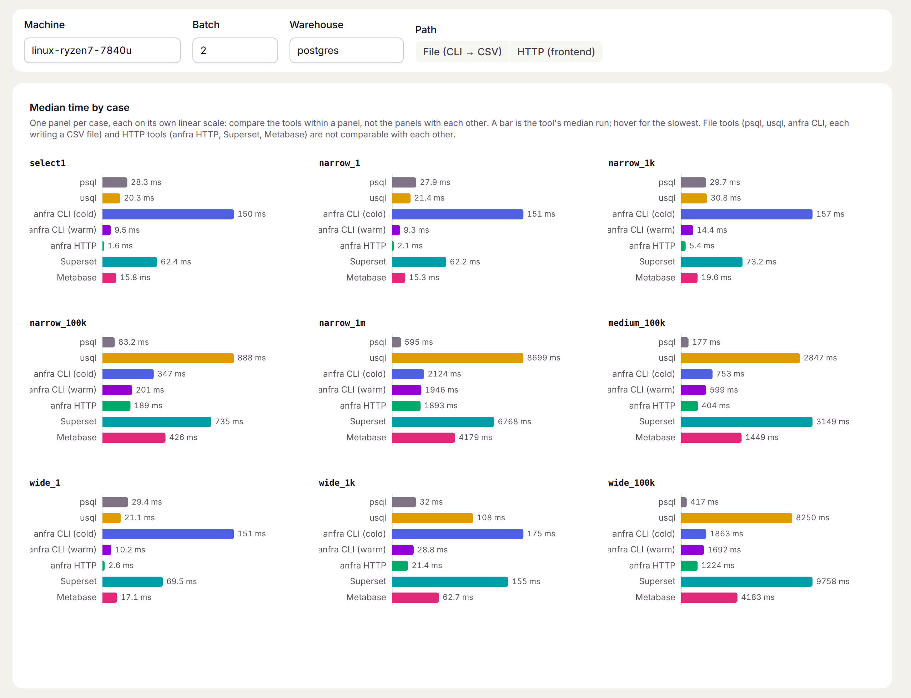

# Batch 2: Postgres, SQL group, every tool

Postgres × psql, usql, anfra (CLI cold, CLI warm, HTTP), Superset, Metabase.
SQL only. Batch 1's tools plus Metabase, all run together and interleaved.
Raw runs: [batch2.jsonl](batch2.jsonl).

- **Run:** 2026-11-18. 1 warm-up round, then 5 measured rounds, tools and
  cases shuffled every round. 315 measured runs, all with the expected rows and
  columns.
- **Versions:** anfra 0.22.0, Postgres 16, Superset 6.1.0, Metabase v0.65.5.1,
  usql v0.21.6, psql 15.18.
- **Machine:** AMD Ryzen 7 PRO 7840U (16 threads), 27 GiB, Linux 7.0. Not
  isolated: other containers were running, idle.
- **How each tool is run:** see [IMPLEMENTATION.md](../../IMPLEMENTATION.md).
  On the file path, every tool writes the whole result to a CSV file.

## Results

Median ms, with the slowest of the 5 runs in brackets. Compare only within a
path.

| Case | psql | usql | anfra CLI, cold | anfra CLI, warm | anfra HTTP | Superset | Metabase |
|---|---:|---:|---:|---:|---:|---:|---:|
| | *file* | *file* | *file* | *file* | *http* | *http* | *http* |
| `select1` | 28.3 (29.3) | 20.3 (20.9) | 150 (159) | 9.5 (9.8) | 1.6 (2.0) | 62.4 (65.8) | 15.8 (18.2) |
| `narrow_1` | 27.9 (30.0) | 21.4 (22.0) | 151 (151) | 9.3 (10.4) | 2.1 (3.0) | 62.2 (71.8) | 15.3 (18.8) |
| `narrow_1k` | 29.7 (41.6) | 30.8 (33.0) | 157 (158) | 14.4 (15.7) | 5.4 (6.0) | 73.2 (74.4) | 19.6 (21.2) |
| `narrow_100k` | 83.2 (84.4) | 888 (893) | 347 (356) | 201 (215) | 189 (203) | 735 (756) | 426 (468) |
| `narrow_1m` | 595 (602) | 8699 (8726) | 2124 (2169) | 1946 (1992) | 1893 (1948) | 6768 (6840) | 4179 (4224) |
| `medium_100k` | 177 (183) | 2847 (2848) | 753 (766) | 599 (608) | 404 (416) | 3149 (3344) | 1449 (1469) |
| `wide_1` | 29.4 (33.6) | 21.1 (23.3) | 151 (153) | 10.2 (10.5) | 2.6 (2.8) | 69.5 (70.0) | 17.1 (18.7) |
| `wide_1k` | 32.0 (33.5) | 108 (110) | 175 (178) | 28.8 (30.7) | 21.4 (22.1) | 155 (162) | 62.7 (68.6) |
| `wide_100k` | 417 (431) | 8250 (8308) | 1863 (1878) | 1692 (1726) | 1224 (1260) | 9758 (10.1s) | 4183 (4249) |

*The [report](../../report/) on batch 2: one panel per case, each on its own linear scale, a bar per tool for its median run. Compare tools within a panel, and only within a path: psql, usql and anfra CLI write a CSV file; anfra HTTP, Superset and Metabase answer over HTTP.*

## What stands out

### HTTP: anfra is 2–10× faster than Metabase, and 4–40× faster than Superset

| Case | anfra HTTP | Metabase | Superset | Metabase ÷ anfra | Superset ÷ anfra |
|---|---:|---:|---:|---:|---:|
| `select1` | 1.6 | 15.8 | 62.4 | 9.9× | 39× |
| `narrow_1k` | 5.4 | 19.6 | 73.2 | 3.6× | 14× |
| `narrow_100k` | 189 | 426 | 735 | 2.3× | 3.9× |
| `narrow_1m` | 1893 | 4179 | 6768 | 2.2× | 3.6× |
| `medium_100k` | 404 | 1449 | 3149 | 3.6× | 7.8× |
| `wide_1k` | 21.4 | 62.7 | 155 | 2.9× | 7.2× |
| `wide_100k` | 1224 | 4183 | 9758 | 3.4× | 8.0× |

- **Metabase is the faster of the two BI tools** on every case: about 2× to 4×
  ahead of Superset. Its fixed cost per query is about 15 ms, against
  Superset's 60 ms and anfra's 2 ms.
- **Metabase's gap to anfra is smallest on narrow results** (about 2.2× from
  100k rows up), and larger on mixed and wide ones (3.4–3.6×). Like Superset,
  it returns every value as JSON in one document, after reading the whole
  result; anfra streams rows as it fetches them.

### File: unchanged from batch 1

anfra's warm CLI is ahead of psql on small results (about 10 ms against 28 ms,
since psql opens a new connection every call), and 2.4–4× behind it on large
ones. The cold CLI adds about 140 ms to every call. usql remains the slowest
tool on the file path. See [batch 1](batch1.md) for the breakdown, and why the
warm CLI is slower than anfra HTTP on large results (the export writes the
whole CSV file before returning its link).

### Batch 1's tools, run again

Every tool measured in both batches came within 11% of its batch 1 median,
case by case, and most within 7% (anfra CLI warm on `narrow_1m`: 2072 ms then
1946 ms; psql: 599 ms then 595 ms). No comparison above changes between the
two batches.

## Caveats

- **Postgres is local**, so each tool's own cost is as visible as it gets. On a
  remote warehouse, the gaps narrow.
- **Metabase** runs with its default settings but for its row limits, raised so
  the 1M-row case returns whole. Its Java heap is 3 GB, and it used 1.7 GB.
- **5 runs per case.** For every cell over 100 ms, the slowest run is within
  10% of the median.
