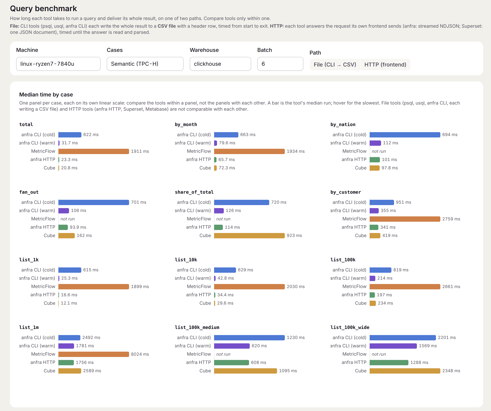

# Batch 6: ClickHouse, semantic group

ClickHouse (TPC-H at scale factor 1) × anfra (CLI cold, CLI warm, HTTP),
MetricFlow, Cube. The same 12 cases, models and answers as Postgres's
[batch 5](batch5.md), on ClickHouse. Raw runs: [batch6.jsonl](batch6.jsonl).

- **Run:** 2026-11-19. 1 warm-up round, then 5 measured rounds, tools and
  cases shuffled every round. 275 measured runs, every one returning its
  case's answer value by value, and 5 cases recorded as not run.
- **Versions:** anfra 0.22.0 with AQL compiler v2, MetricFlow 0.214.0
  (`dbt-metricflow` 0.16.0, dbt-core 1.12.7, dbt-clickhouse 1.10.3), Cube
  v1.8.28, ClickHouse 26.8.39.19.
- **Data:** TPC-H copied from the Postgres one (`clickhouse/tpch.sh`): the same
  values, checked with TPC-H's Query 1, so the same answers apply.
- **Machine:** AMD Ryzen 7 PRO 7840U (16 threads), 27 GiB, Linux 7.0. Not
  isolated: other containers were running, idle.
- **How each tool is run:** see [IMPLEMENTATION.md](../../IMPLEMENTATION.md).
  anfra runs the same AQL on the `tpch_ch` dataset (`tpch`, with ClickHouse as
  its data source); MetricFlow runs `mf query` in `metricflow-ch/`; Cube runs
  its REST API on a second Cube, `cube-ch`, with the same model.
- **The model differs from batch 5 in one place:** Cube's share of total
  multiplies by `1.0`, as anfra's AQL does, so its division is floating point.
  Without it, ClickHouse keeps the dividend's 4 decimals and returns 0.0399
  instead of 0.03997.

## Results

Median ms, with the slowest of the 5 runs in brackets. Compare only within a
path. The last column is the hand-written SQL that defines each case's answer,
its execution time inside ClickHouse (best of 3), as a guide to how much of
each time is the warehouse's.

| Case | anfra CLI, cold | anfra CLI, warm | MetricFlow | anfra HTTP | Cube | Hand-written SQL (ClickHouse, best of 3) |
|---|---:|---:|---:|---:|---:|---:|
| | *file* | *file* | *file* | *http* | *http* | |
| **Aggregates** | | | | | | |
| `total` | 622 (631) | 32 (46) | 1911 (1946) | 23 (32) | 21 (22) | 14 |
| `by_month` | 663 (670) | 80 (150) | 1934 (2002) | 66 (76) | 72 (74) | 56 |
| `by_nation` | 694 (697) | 112 (128) | not run ¹ | 101 (128) | 98 (337) | 76 |
| `fan_out` | 701 (1141) | 106 (108) | not run ¹ | 94 (109) | 162 (183) | 53 |
| `share_of_total` | 720 (724) | 126 (183) | not run ¹ | 114 (118) | 923 (1167) | 76 |
| `by_customer` | 951 (958) | 355 (364) | 2759 (2787) | 341 (344) | 419 (437) | 132 |
| **Listings** | | | | | | |
| `list_1k` (2 columns) | 615 (1082) | 25 (36) | 1899 (1938) | 17 (18) | 12 (26) | 3 |
| `list_10k` (2) | 629 (1103) | 43 (75) | 2030 (2108) | 34 (38) | 30 (93) | 3 |
| `list_100k` (2) | 819 (1280) | 214 (232) | 2661 (2703) | 197 (227) | 234 (261) | 4 |
| `list_1m` (2) | 2492 (2923) | 1781 (1825) | 8024 (8033) | 1756 (1781) | 2589 (2798) | 6 |
| `list_100k_medium` (10) | 1230 (1242) | 620 (640) | not run ¹ | 608 (642) | 1095 (1156) | 39 |
| `list_100k_wide` (20) | 2201 (2232) | 1569 (1591) | not run ¹ | 1288 (1296) | 2348 (2532) | 81 |

1. Not run, for the same reasons as on Postgres: each needs a denormalized
   model. See [batch 5](batch5.md#results) and
   [cases/semantic/metricflow.json](../../cases/semantic/metricflow.json).

*The [report](../../report/) on batch 6: one panel per case, each on its own linear scale, a bar per tool for its median run. Compare tools within a panel, and only within a path: anfra CLI and MetricFlow write a CSV file; anfra HTTP and Cube answer over HTTP. MetricFlow appears only in the cases it runs.*

## What stands out

### Correctness: every tool that ran a case returned the right numbers

Every run of every case matched its answer, value by value, on ClickHouse as
on Postgres, once Cube's share of total was made floating point (above).

### ClickHouse leaves the tools' own cost exposed

ClickHouse runs every hand-written answer in 3–132 ms, against 30 ms–2.6 s on
Postgres. So nearly all of each time here is the tool: compiling, fetching,
converting and delivering. A tool's time on ClickHouse is close to its own
cost; on Postgres it was mostly the warehouse's.

### HTTP, aggregates: even, except where Cube's SQL does more

| Case | anfra HTTP | Cube | Cube ÷ anfra |
|---|---:|---:|---:|
| `total` | 23 | 21 | 0.89× |
| `by_month` | 66 | 72 | 1.10× |
| `by_nation` | 101 | 98 | 0.97× |
| `fan_out` | 94 | 162 | 1.73× |
| `share_of_total` | 114 | 923 | 8.1× |
| `by_customer` | 341 | 419 | 1.23× |

- **`share_of_total`: Cube's SQL takes ClickHouse 769 ms, anfra's 90 ms**
  (each its execution time inside ClickHouse, best of 3). As on Postgres, Cube
  computes revenue by nation twice, each with the four-table join, then joins
  the results back by nation: 10 joins in all, against anfra's 4. ClickHouse is
  much slower than Postgres at a query with that many joins, so the gap that
  was 1.6× on Postgres is 8× here.
- **`fan_out`: Cube's SQL takes 123 ms, anfra's 72 ms** (7 joins against 6).
- **On the other aggregates, the two are within about 10%**, and ClickHouse's
  part of each time is small.

### HTTP, listings: the same pattern as on Postgres

| Case | anfra HTTP | Cube | Cube ÷ anfra |
|---|---:|---:|---:|
| `list_1k` (2 columns) | 17 | 12 | 0.73× |
| `list_10k` (2) | 34 | 30 | 0.86× |
| `list_100k` (2) | 197 | 234 | 1.19× |
| `list_1m` (2) | 1756 | 2589 | 1.47× |
| `list_100k_medium` (10) | 608 | 1095 | 1.80× |
| `list_100k_wide` (20) | 1288 | 2348 | 1.82× |

Cube is faster on small listings; anfra on large ones, and the gap grows with
width, as on Postgres. ClickHouse lists every one of these in 3–81 ms, so these
times are the tools' own delivery.

### File: MetricFlow pays about 1.9 s per call

| Case | anfra CLI, warm | anfra CLI, cold | MetricFlow | MetricFlow ÷ anfra cold |
|---|---:|---:|---:|---:|
| `total` | 32 | 622 | 1911 | 3.1× |
| `by_month` | 80 | 663 | 1934 | 2.9× |
| `by_customer` | 355 | 951 | 2759 | 2.9× |
| `list_1k` | 25 | 615 | 1899 | 3.1× |
| `list_100k` | 214 | 819 | 2661 | 3.2× |
| `list_1m` | 1781 | 2492 | 8024 | 3.2× |

With ClickHouse answering in milliseconds, each tool's fixed cost per call
stands out: about 1.9 s for MetricFlow (a Python process, dbt and its
manifest), about 0.6 s for anfra's cold CLI (its sidecars), and none for
anfra's warm CLI, which forwards each call to `anfra serve`.

## Caveats

- **ClickHouse is local**, so each tool's own cost is as visible as it gets.
- **The hand-written SQL column is ClickHouse's execution time**, best of 3,
  measured separately, not a median of the runs.
- **Small times vary more.** Several cells of tens of milliseconds have a
  slowest run 1.4–3.5× their median (Cube's `by_nation` and `list_10k`, anfra's
  warm CLI on `by_month`). The medians are what the comparisons use.
